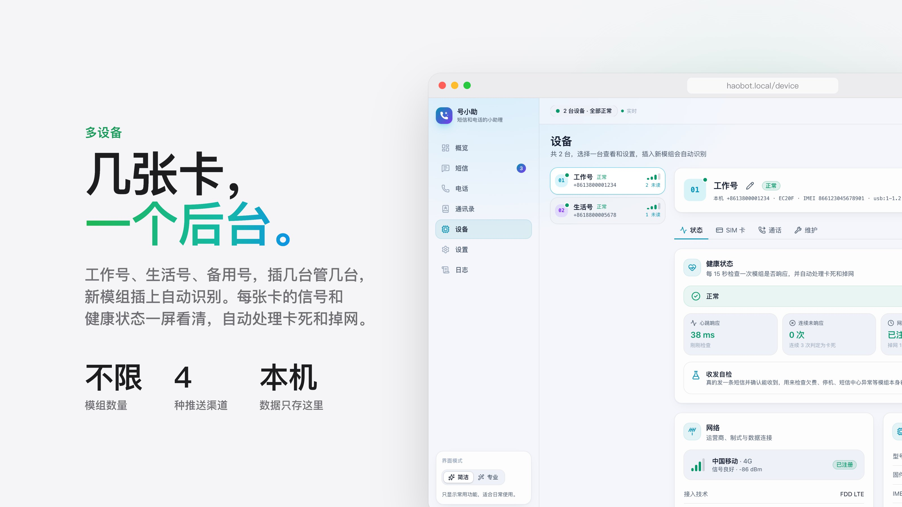

# simcallhub (SIMs Manager)

[中文](README.md)


simcallhub watches the phone number in a cellular modem (Quectel EC20; other Quectel and SIMCom modules are recognised but untested) plugged into a computer you keep running. It:

- receives SMS and sorts them with an LLM (verification codes, bills, deliveries, marketing, spam, carrier, notices, personal). Messages are redacted locally before they are sent to the model;
- lets an AI answer calls you miss. It asks who is calling and why, then saves a summary. It uses Alibaba Cloud Bailian (Model Studio) realtime speech models;
- pushes messages, missed calls and call summaries to Telegram, Feishu (Lark), DingTalk or WeCom;
- serves a web admin UI for conversations, replies, calls through the modem's SIM (browser microphone), device health and settings.

It is a single Go binary for macOS and Linux (including NAS boxes) with an embedded React UI and a local SQLite database. The UI and most documentation are in Chinese, since the project targets mainland Chinese carriers.




<sub>The numbers, messages and calls in these screenshots are made-up demo data.</sub>

> **Before you use it**
>
> - Use it only on your own number. Do not use it for bulk messaging or to intercept messages that are not yours.
> - **Call recording**: many jurisdictions require telling the other party. By default only calls the AI answers are recorded. You can turn recording off.
> - **AI answering**: by default the assistant does not announce that it is an AI, but it answers truthfully when sincerely asked. Where the law requires disclosure, enable "接通后主动说明自己是 AI" in the AI answering settings.
> - **Where data goes**:
>   - redacted SMS go to the LLM you configure;
>   - call audio is streamed to Bailian while the AI answers;
>   - pushed content passes through the push platform.
>
>   Everything else stays on your machine.
> - MIT licensed, without warranty. You bear any costs (SMS, calls, LLM usage) and consequences of using it.

## Quick start

Plug in the modem, then on Linux or macOS run:

```sh
curl -fsSL https://raw.githubusercontent.com/chenpinetree/SimCallHub/main/scripts/install.sh | sh
```

The script picks the release for your system and CPU, checks its SHA256, puts `simcallhub` in `/usr/local/bin` (or `~/.local/bin` when that is not writable) and offers to start it. Answer `y` to LAN access on a headless NAS or Raspberry Pi. It then prints the admin UI address and the first password for the user `admin`. The certificate is self-signed: accept it in the browser.

Then, in 设置 (Settings), configure classification (智能分类), push channels (消息推送) and AI answering (AI 接听). Each section has a test button.

The agent runs in the background and keeps running when you close the terminal. Nothing is set to start with the computer:

```sh
simcallhub start        # start; -lan allows LAN access. Options are remembered for the next start
simcallhub status       # running? where is the admin UI? (exit code 3 when stopped)
simcallhub stop         # stop
```

- **Upgrade**: run the install command again. A running agent is stopped, replaced and started again with its options.
- **Slow GitHub**: `SIMCALLHUB_VERSION=v1.2.3` picks a release; `SIMCALLHUB_MIRROR` prefixes GitHub download links. Or download a release by hand and run `./simcallhub start`.
- **Linux permissions**: as a normal user you need the `dialout` group (`uucp` on Arch) for the modem's serial ports. `simcallhub udev-rules` prints udev rules that keep ModemManager off the modems and let `plugdev` reset them when they hang.
- **Uninstall**: `simcallhub stop` and delete the program. Data is in `~/.simcallhub`.

Building from source:

```sh
brew install libusb pkg-config   # macOS only
make build                       # bin/simcallhub
make linux                       # static Linux amd64/arm64 binaries (serial transport)
```

Other commands:

| Command | What it does |
|---|---|
| `simcallhub serve` | Run in the foreground (Ctrl+C stops it) |
| `simcallhub passwd` | Change the admin password |
| `simcallhub backup` / `restore` | Move your data to another machine |
| `simcallhub at 'ATI'` | Send raw AT commands while the service is stopped |
| `simcallhub version` | Print the version |

See [README.md](README.md) for the full documentation: flags, health checks, calls, AI answering, push rules, HTTPS and security.

## Contributing

Issues and pull requests are welcome; see [CONTRIBUTING.md](CONTRIBUTING.md). Report security problems privately as described in [SECURITY.md](SECURITY.md).

## License

[MIT](LICENSE)
